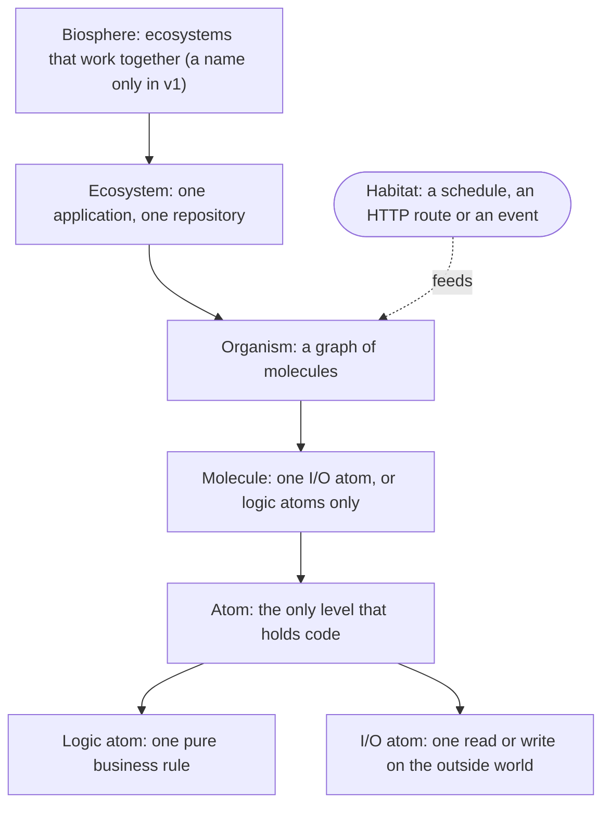
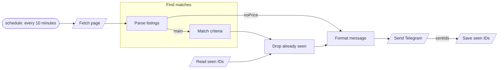

# Ligand design

Agreed on 2026-10-11 in a design interview that replaced the first draft. This document is the narrative overview. The decisions themselves, with their reasons, are the ADRs in [`docs/adr/`](adr/), and the vocabulary is in the [glossary](../GLOSSARY.md). Where this document and an ADR disagree, the ADR wins.

## Summary

Ligand is a TypeScript framework in which a backend is a graph of typed nodes. Habitats feed organisms their input, atoms do the work, and everything above the atoms is wiring that a canvas draws and edits. Each logic atom is one business rule with a contract and tests. AI writes its implementation once, held to those tests, and the code is committed and reviewed like any other code. Developers own the contracts and the tests.

The bet is that AI adds a new layer of abstraction, the way compilers made writing assembly unnecessary: developers define and verify behaviour through types, examples and tests, and AI fills in the implementation. Unlike a compiler, AI isn't deterministic, so its output is committed, and every code bug found in production can strengthen the tests.

## Goals and non-goals

Version 1 is for developers building backends in TypeScript who adopt Ligand themselves. The listing bot is its first real application and its tutorial.

Goals:

- An overview of what an application does, readable at a glance on the canvas.
- AI-written code that can be verified: every logic atom carries the tests that define its behaviour, and the AI can't change them.
- Files that stay language-neutral (YAML and JSON Schema), so other languages can be added later without changing how graphs are drawn.
- Every atom can run, and be tested, on its own.

Version 1 is done when:

1. The listing bot has run unattended on Ligand and completed one full fix loop. "Unattended" means detection, capture and the proposal happen with nobody present; both approvals stay human.
2. The docs take a new developer from install to a running organism with an AI-written atom held to tests.
3. Two developers other than the author have built something with Ligand without help.

Not in version 1 (see [future improvements](future-improvements.md)): UI and frontend applications, languages other than TypeScript, serverless deployment, more than one process per ecosystem, users who don't write code, genomes, and a working biosphere level.

## Prior art and positioning

As of October 2026, no tool was found that combines all three of a typed node graph, AI-written logic held to tests, and a backend runtime. BuildShip comes closest, with AI-generated nodes and unit tests in a visual backend builder, but nothing found shows those tests gating what the AI writes.

| Project | Overlap | What Ligand adds |
| --- | --- | --- |
| [Mastra](https://mastra.ai/docs/workflows/overview) | Workflows of typed steps with input and output schemas, shown as a graph in its Studio | The graph as the main editor, and AI-written nodes held to tests |
| [Kiro](https://kiro.dev/docs/specs/correctness/) | Requirements turned into property-based tests | Tests attached to every node of a typed graph rather than to prose specs |
| [BuildShip](https://buildship.com) | A visual backend builder with AI-generated nodes, custom code and unit tests | Tests that gate what the AI writes, and code that lives in your repository |
| Kedro and Kedro-Viz | Pure function nodes, I/O kept apart, a visualiser that rereads the code | Typed ports instead of wiring by name, and AI-written nodes |
| [Encore](https://encore.dev/docs/ts/observability/flow) | A Flow architecture diagram that updates as the code changes | A graph that is itself the source, edited on a canvas |
| [iii](https://iii.dev) | Functions, triggers and workers in several languages on one engine, with one trace per request | A typed graph that is itself the source, and AI-written nodes held to tests |
| [Flyde](https://www.flyde.dev/docs/) | Visual flows in `.flyde` files that integrate with TypeScript, with node positions stored next to the wiring (little activity since mid-2025) | Layout kept apart from wiring, so moving a node isn't a diff |
| [n8n](https://docs.n8n.io/build/code-in-n8n/get-coding-help-from-ai), [Windmill](https://www.windmill.dev/docs/core_concepts/ai_generation) | AI-generated code steps (in n8n, in its Cloud edition) | A test gate on everything the AI writes |
| Node-RED, ComfyUI, Unreal Blueprints | The visual node-editing experience | Applied to tested backend logic |

Motia, once the closest match, was deprecated on 2026-04-16 in favour of iii, a lower-level runtime from the same team; its repository now belongs to iii, and the framework has been removed from it ([research](research/motia.md)).

## The levels



The levels follow chemistry strictly: each level is made only of the level below it ([ADR 0003](adr/0003-atoms-hold-all-code.md)). Only atoms hold code. Molecules and organisms are graph files, and the ecosystem graph is derived from the organisms' event habitats. A lone atom sits in a molecule of one atom, the way noble gases are monatomic molecules, and the canvas draws it as just the atom.

- A **logic atom** is one business rule: a synchronous, default-exported function that takes an object with a field per input port and returns an object with a field per output port it emits. It has no contact with the outside world, not even the clock: the run's start time and any configuration arrive on ports, and `ligand check` rejects reading the clock, random numbers, environment variables, files or the network in its implementation. It may import only pure packages listed in `ligand.yaml` and files in its own folder. Logic atoms run in worker threads with a time limit per call, 1 second by default and adjustable per atom; validating the atom's port values happens inside the worker and counts toward that limit ([ADR 0011](adr/0011-logic-atoms-run-in-workers.md)).
- An **I/O atom** reads from or writes to the outside world, and declares which (`effect: read` or `effect: write`). It is a thin async function: it performs the effect and returns the raw result, and anything that interprets the result is a logic atom. It receives a context with an abort signal, secrets, an idempotency key (the run ID plus the atom's path), `park()`, `retryable()` and a `fetch` whose exchanges Ligand can record ([ADR 0010](adr/0010-effect-runtime-atoms-never-see-it.md)); `ligand check` flags the global `fetch` in an I/O atom. Recordings live in `atoms/<name>/recordings/` and are captured by Ligand from real exchanges, never written by the AI. Each attempt has a time limit, 30 seconds by default and adjustable per atom.
- A **molecule** is either a single I/O atom or a graph of logic atoms only. Every molecule with more than one atom is therefore pure, and every read and write the application does shows up as its own node at organism level.
- An **organism** is a graph of molecules that lives in one or more habitats, all delivering the same input type. Its outputs are its result.
- An **ecosystem** is a graph of organisms wired together by events. One repository is one ecosystem.

The draft's granularity rules now apply to logic atoms: name it with a domain verb, split on tests, merge on coupling, and keep it to the largest unit whose contract fits in one short description. Programming verbs such as map and filter live inside an atom. A node that seems to need many inputs is missing a type, and the canvas warns above three inputs.

## Contracts, types and tests

A **contract** is a node's name, description and typed ports. Its tests sit beside it and pin its behaviour. Everything except code is data ([ADR 0006](adr/0006-everything-except-code-is-data.md)): contracts, graphs, habitats and example tables are YAML, so the canvas reads and writes them without running any code.

```yaml
ligand: 1
kind: logic-atom
name: Parse listings
description: Extracts the listings from a search results page.
inputs:
  page: { type: string, contentMediaType: text/html }
outputs:
  main:    { type: array, items: { $ref: ../../types/listing.yaml } }
  noPrice: { type: array, items: { $ref: ../../types/listing.yaml } }
```

```ts
import type { Inputs, Outputs } from './contract.gen'

export default function parseListings({ page }: Inputs): Outputs {
  const listings = extract(page)
  const priced = listings.filter((l) => l.price !== undefined)
  const unpriced = listings.filter((l) => l.price === undefined)
  return unpriced.length ? { main: priced, noPrice: unpriced } : { main: priced }
}
```

**Types** are JSON Schema Draft 2020-12, kept in shared YAML files that refer to each other. TypeScript types are generated from them (`*.gen.ts`, not committed). Ligand restricts the dialect: `$anchor`, `$dynamicRef`, `$dynamicAnchor` and `$data` are rejected, and its own `x-ligand-*` keywords mark fields as personal or secret and lists as unordered. Bytes travel as base64 strings. Every value is validated at every port, in production too, by Ajv with the `re2js` regex engine, so a pattern can't backtrack catastrophically on scraped text; `ligand check` rejects patterns with lookaheads or backreferences, which RE2 can't run ([ADR 0013](adr/0013-ajv-validates-ports.md)). `ligand check` also validates every example and fixture value with `@hyperjump/json-schema` and fails when the two validators disagree.

**Tests** for a logic atom come in three kinds, all run by Vitest:

- **Examples**: rows of input and the exact set of output values it must produce, and nothing else. Order counts unless the contract marks a list port as unordered.
- **Fixtures**: a saved real-world input, such as a results page, paired with its expected output.
- **Properties**: rules every output must satisfy, checked against generated inputs with fast-check.

`ligand check` runs mutation testing (StrykerJS) on every logic atom whose implementation changed, and fails below a configurable score, 80% by default, so weak tests are caught before an AI is held to them. There are no hidden tests in v1, because an external agent can read the whole repository. An I/O atom's example is an input, the recordings it plays back and the exact output expected. A pure molecule may have examples. An organism is tested by **golden runs**: committed, scrubbed recordings of real runs that check both its outputs and everything it sends ([ADR 0016](adr/0016-golden-runs-check-what-an-organism-sends.md)).

## How a graph runs

A run is one firing of an organism's habitat ([ADR 0002](adr/0002-one-value-per-wire-per-run.md)):

- Graphs are acyclic, and each node runs at most once per run.
- A wire carries one value per run, and that value may be a list.
- A node may emit on any subset of its outputs. An output that isn't emitted skips everything downstream of it; an empty list is still a value.
- A node runs once every node feeding it has finished or been skipped, all its required inputs have values, and at least one input has a value. Inputs marked `required: false` are optional.
- An input port takes exactly one wire; merging is the job of a logic atom with several inputs. An output port can feed any number of wires.
- Order comes only from data. An atom that must run after another takes that atom's output: Save seen IDs saves the IDs that Send Telegram actually sent.
- Repetition such as pagination lives inside an atom, not as a loop in the graph.
- A **mapping** on a wire may only select, rename and nest fields. Anything that computes is a logic atom with tests.
- An **outcome** is an extra named output for a business case the graph must show, such as a listing without a price.

Every node in a graph file has a name, unique in that graph, so the same atom can be used twice. Wires are type-checked by generating a small TypeScript file per graph and letting the compiler check it. Configuration, such as a URL or search criteria, is a constant wired to a port, and may reference an environment variable (`${env:NOTIFY_URL:-https://example.test}`), resolved when a run starts and recorded. Secrets are the only input that doesn't travel on a port: they come from environment variables, referenced by name, and only I/O atoms receive them.

## Habitats

An organism lives in its habitats: the habitat feeds it input and, for HTTP, takes its answer.

- **Schedule**: a cron expression and an IANA time zone (UTC by default). A local time that doesn't exist on a given day runs at the next valid minute, and one that occurs twice runs once. Missed ticks are skipped and logged, unless `catchUp: latest` asks for one catch-up run at startup.
- **HTTP** ([ADR 0014](adr/0014-http-habitats-always-answer.md)): the habitat owns the whole exchange and always answers.
  - Before a run: failed authentication answers 401 (the habitat checks bearer tokens and webhook signatures; anything richer is an atom with an `unauthorized` outcome), an unsupported `Content-Type` 415, an unsatisfiable `Accept` 406, input that doesn't fit its type 400, a body over 1 MB 413.
  - Codecs translate between the wire format and typed values: JSON, XML (guided by the port's type and OpenAPI's `xml` annotation), plain text, forms and bytes. The organism receives `{ params, query, body }` plus any headers the habitat names.
  - The organism must emit exactly one mapped output per run. A response mapping gives each output a status and selects its headers from fields of the output value; full header values, such as a `Location` URL, are computed in a logic atom. Zero or several outputs is a logic bug that parks the run and answers 500, and a run that parks for any other reason also answers 500.
  - `ligand check` fails if an output has no status, if a header refers to a field that is missing or isn't a string, if the route's path parameters, query and named headers don't match the organism's input type, or if a media type can't represent a port's type, such as `text/plain` for an object.
  - The habitat waits up to 30 seconds, then answers 504 while the run carries on. With `respond: accepted` it answers 202 with the run ID at once, and an output-count error then only parks the run. Every response carries a `Ligand-Run-Id` header.
  - At most 64 runs at once per habitat by default, counting runs still going after their 504; beyond that, 503 with `Retry-After`. Rate limits per caller are left to a reverse proxy.
- **Event** ([ADR 0008](adr/0008-organisms-start-one-another-through-outputs.md)): any output of an organism can be published as an event, and another organism subscribes by living in an event habitat such as `event: poll-listings.main`. That declaration in the subscriber's organism file is the only place a subscription lives. In v1, events are delivered in-process and at least once, with no message broker: the publishing run starts each subscriber run with an execution key made of the emitting run, the port, the subscriber organism and its habitat, and a start repeated after a crash is deduplicated. Atoms in a subscriber run can still repeat after a crash, which is what I/O atoms' idempotency keys are for.

Each habitat has an overlap policy for new input that arrives while a run it started is still going: `skip` (the default for schedules), `queue` (events) or `allow` (HTTP). A parked run doesn't count as going.

## The role of AI

AI works through five tasks: **generate** a logic or I/O atom from its contract and tests, **describe** a node (a suggested name and description), **fix** an atom from a failing example, **improve** the tests when the mutation gate fails, by proposing examples that catch the surviving mutants, and **diagnose** a parked run that isn't a code bug, as a short report with no diff. Suggesting refactors and better splits is future work.

The rules ([ADR 0001](adr/0001-ai-writes-only-implementations.md)):

- AI writes only implementation files. Ligand enforces this where it hands work to an AI: `ligand generate` and `ligand fix` snapshot every other file before a task and reject the result if anything else changed.
- What the AI produces waits as a **proposal** until you approve it: an example, a golden-run update, a contract description or an implementation change. Approving on the canvas or with `ligand review` writes it into the working tree, and committing stays with you; pending proposals wait in `.ligand/proposals/`. In a fix pull request, the example is approved in the pull request, and the implementation diff that follows is reviewed like any other code.
- When a production failure becomes a test, the AI proposes the expected output and a developer approves that example before the AI writes a fix.
- When the contract and tests can't all hold, the AI returns an **escalation** instead of forcing the tests to pass. Models under pressure edit or special-case tests; the path rule stops the first, and the mutation gate and escalation make the second less likely.
- The AI never re-blesses a golden run.

There are two paths, sharing one task shape: the contract, the tests, the current implementation and, for a fix, the captured failing case go in, and an implementation diff that passes `ligand check`, or an escalation, comes out ([ADR 0004](adr/0004-two-ai-paths-one-task-shape.md)).

- The **built-in path** is a thin loop over `effect/ai` with your own key (Anthropic, OpenAI or OpenRouter in v1): generate, check, feed back the failures, escalate after a fixed number of attempts.
- The **external path** hands the same task to a coding agent you configure. For the agents you choose (Claude Code, Codex, GitHub Copilot, Cursor, Kiro, Gemini CLI), `ligand init` writes:
  - a marked Ligand section in `AGENTS.md`, which all six read (Gemini CLI through its `context.fileName` setting). No `CLAUDE.md` is created, because Claude Code reads `AGENTS.md` itself when there is none; an existing `CLAUDE.md` gets an `@AGENTS.md` import.
  - the MCP server `ligand mcp` in each agent's project configuration (`.mcp.json`, `.codex/config.toml`, `.cursor/mcp.json`, `.kiro/settings/mcp.json`, `.gemini/settings.json`). Copilot's cloud agent has no repository file, so `ligand init` prints the JSON to paste into the repository settings.
  - Ligand's skills in `.agents/skills`, `.claude/skills` and `.kiro/skills`.

  `ligand agents sync` regenerates them after an upgrade. An agent you drive interactively is guided by these files, but its edits are outside the enforced rule.

## The runtime

Ligand's runtime is built on Effect 4, including modules Effect still marks unstable, pinned to one exact version and upgraded only in Ligand releases ([ADR 0010](adr/0010-effect-runtime-atoms-never-see-it.md)). Atoms never see Effect.

**The workflow engine** ([ADR 0012](adr/0012-effect-workflow-runs-organisms.md)): each run is one `effect/workflow` execution of a generic workflow that walks the organism's graph, and every atom is an activity named by its path, so a resumed run never recomputes a completed atom. The execution key includes the organism and the habitat, plus the run ID, the scheduled time, or the emitting run and port. Before any start, the runtime checks an index of execution keys kept next to the run log, so a restart, a replay or a rebuild can't start the same run twice. The workflow engine's database is disposable: anything that must survive lives in the run log or the store. Secret fields are encrypted before they reach its storage, with a key from an environment secret, and a run's rows are deleted when it completes; parked runs keep theirs until resolved. Parked runs can be rebuilt on a fresh engine from the run log, except those whose upstream outputs include secret fields, which are discarded or rerun by explicit choice.

**The run log** ([ADR 0005](adr/0005-run-log-stores-outputs-only.md)) is Ligand's own record: one JSON line each time an atom runs, holding the run ID, the path of node names, the duration, the attempt and the value on each port that emitted. Inputs aren't stored; they are rebuilt from upstream outputs through that graph version's wiring. A run's first line holds its habitat, start time, payload, resolved environment references, graph version and execution key. Large values go to content-addressed files, and failed I/O attempts keep their `ctx.fetch` exchanges as recordings. Secret fields are never written. Personal values are removed after 30 days, and lines after 90 days by default; parked runs keep theirs until resolved. `ligand logs` and the canvas display lines as `ecosystem > organism > molecule > atom: 12ms, main: 18 listings`, starting at the biosphere if `ligand.yaml` names one.

**Failures** ([ADR 0009](adr/0009-only-io-atoms-retry.md)): only I/O atoms retry, 3 attempts with backoff by default, set per atom in the organism file. They retry only for explicit reasons: a failure of `ctx.fetch` itself, an attempt that exceeds its time limit, or anything thrown through `ctx.retryable()`. Responses that are answers, such as a 404, are outcomes declared in the atom's contract, and any other throw is a bug. A run **parks** at the atom that couldn't continue when an I/O atom runs out of retries, when an atom throws a bug, when a logic atom exceeds its time limit, when a value doesn't fit its type, when an HTTP organism emits the wrong number of outputs, or when an atom calls `park()`. A parked run is a suspended workflow execution; resuming restarts at the failed atom, and only if the graph upstream of it is unchanged. A run interrupted by a deploy that changed its upstream graph parks with the reason "graph changed".

**The store** ([ADR 0018](adr/0018-store-is-versioned-key-value-storage.md)) is a pair of I/O atoms, Read and Write, over `.ligand/store.db`. Read emits a version; Write takes an optional expected version and has a `conflict` outcome, so overlapping runs can't silently lose an update. Values carry their type's hash: a value that no longer fits its type comes out on a `stale` outcome, and `ligand check` warns when a stored type changes incompatibly. Keys are namespaced per ecosystem and can expire.

**Shutdown**: on `SIGTERM`, Ligand stops accepting requests (503) and firing schedules, waits up to 30 seconds for runs in flight, and exits. Unfinished runs resume at their last completed atom on the next start. `GET /.ligand/health` answers 200 once the graph is loaded and the workflow engine is up; the `/.ligand/` prefix is reserved.

## Development

`ligand dev` serves the **canvas**, a local web app built on React Flow, next to the running process. The canvas writes graph files (wiring, mappings, habitats) and contracts, keeps node positions in a separate layout file per graph so moving a node never shows up in the wiring diff, shows each node's test status and the last run's value on every wire, starts AI tasks, and shows proposals to approve or reject. Implementations and coded tests are edited in your own editor.

In development, schedules don't fire on their own: you start runs from the canvas with a payload you type or one taken from a logged run. HTTP habitats are served on a local port. Write atoms that go through `ctx.fetch` make **dry runs**: their `ctx.fetch` sends nothing and replays the newest matching recording, or answers a synthetic empty 200 if there is none, and the canvas marks the run as dry. The atom's code still runs, so its output is real. A write atom that doesn't go through `ctx.fetch`, such as one using a database driver, has no dry mode and has to be switched live explicitly. Store atoms run for real against a dev store you can reset.

The CLI: `init`, `new atom|molecule|organism`, `dev`, `check`, `build`, `generate`, `fix`, `describe`, `review`, `runs list|show|resume|rerun|discard`, `start`, `logs`, `pull`, `agents sync` and `mcp`.

## Production

`ligand build`, run in CI, writes a `dist/` with the precompiled validators, the graph and its hash. `ligand-runtime start` runs it with the atom sources and refuses to start on a hash mismatch; `ligand start` in the CLI wraps it ([ADR 0015](adr/0015-production-runs-a-built-dist.md)). Atoms run through Node's type stripping, so Ligand needs Node 24.12 or later, and `ligand check` rejects syntax that stripping can't run: enums, namespaces with runtime code, parameter properties, import aliases and decorators. Atom packages ship compiled JavaScript, because Node won't strip types inside `node_modules`: a package lists its atoms in `package.json` under `ligand.atoms`, each with its contract and types, and graphs refer to them by package path, such as `@ligand/atoms-http/request`. One process runs per ecosystem, enforced by a lock on `.ligand/`.

When a run parks, production feeds the fix loop ([ADR 0017](adr/0017-production-fixes-as-two-stage-pull-requests.md)):

1. The runtime calls a webhook. `ligand init` can scaffold a CI job as its target.
2. The job pulls the parked run through the admin endpoint (HTTP and MCP), which is off unless `LIGAND_ADMIN_TOKEN` is set, listens on localhost unless configured otherwise, and serves only scrubbed values. Recordings' response bodies count as unstructured personal values unless their type says otherwise. Originals leave production only when an operator asks for them from their own machine (`ligand pull --original`).
3. `ligand pull` reruns the failed atom on the scrubbed input, replaying recordings and never calling out live, and reports whether it still fails the same way. If it doesn't, a developer hand-edits a reproduction or keeps the original value locally, uncommitted and noted in the run log.
4. The job opens a pull request containing only the proposed example, marked `proposed: true`. If a captured value can't be scrubbed automatically, it commits nothing and marks the pull request "needs manual scrub".
5. A developer approves the example in the pull request or with `ligand review`, which removes the marker. Only then does the job push the implementation fix. CI refuses to merge while any marker remains, and checks that the job's commits touch only implementation files and approved proposals.
6. Parked runs are resumed, rerun or discarded with `ligand runs` or through the admin endpoint. Nothing resumes on its own, except with the opt-in `resumeOnFix` per organism: after a deploy, a parked run resumes if the failed atom's implementation changed and an approved example covers its captured input.

Each parked run has a cap on AI attempts and model spend, and Ligand never commits to the main branch. Runs can optionally be exported to OpenTelemetry as traces with a span per atom, carrying names, durations, attempts and outcomes, never values. Ligand itself sends no telemetry.

## Project layout

```
ligand.yaml                         # the ecosystem: organisms, pure packages, optional biosphere name
types/
  listing.yaml
organisms/
  poll-listings.yaml                # graph, habitats, constants
  poll-listings.layout.yaml         # node positions for the canvas
  poll-listings.golden/             # golden runs
molecules/
  find-matches.yaml
  find-matches.layout.yaml
atoms/
  parse-listings/
    contract.yaml
    examples.yaml
    fixtures/
    parse-listings.ts               # the implementation: the only file AI may write
    parse-listings.property.test.ts
  send-telegram/
    contract.yaml
    examples.yaml
    recordings/
    send-telegram.ts
.ligand/                            # gitignored: run log, value files, proposals, engine.db, store.db
dist/                               # from ligand build
```

Atoms and molecules are defined once and used by name; a molecule of one atom has no file of its own.

## Worked example: the listing bot



The organism lives in a schedule habitat. Slanted boxes are I/O atoms, each a molecule of one atom; the rest are logic atoms. Fetch page and Read seen IDs are reads; Send Telegram and Save seen IDs are writes, and Save seen IDs takes the IDs Send Telegram actually sent, so a failed send never marks listings as seen. Format message has two optional inputs, so it runs for new listings, for listings without a price, or both. Match criteria compares against the run's start time and the search criteria, both arriving on ports. Parse listings is tested with saved result pages. When the site's markup changes, the failing page becomes a proposed fixture (scrubbed, or marked "needs manual scrub" if it can't be scrubbed automatically), a developer approves its expected output, and the AI fixes the atom. In the tutorial, a webhook atom replaces Send Telegram, so no account is needed.

## Licences and packages

Licences follow where code runs ([ADR 0007](adr/0007-licences-by-where-code-runs.md)):

- `@ligand/cli` (EUPL-1.2): the dev server, canvas, `check`, `build`, the AI paths, and `ligand start` as a wrapper.
- `@ligand/runtime` and atom packages such as `@ligand/atoms-http` (MPL-2.0): everything that runs in production, including `ligand-runtime start`. A production install needs no EUPL code.
- Everything Ligand writes into your repository (scaffolds, generated types, agent files, `dist/`) is 0BSD.

Dependencies point one way: tools may import runtime libraries, never the reverse. EUPL's compatibility clause, which allows a combined EUPL and MPL work to be distributed under MPL, needs legal review if protection against hosted use is the goal.

## Risks and mitigations

| Risk | Mitigation |
| --- | --- |
| Regeneration changes behaviour on inputs no test covers | Generate once and commit; regenerate only on request; properties and a mutation gate |
| Tests only cover inputs someone thought of | Property tests; every production failure caused by a code bug can become an approved example or fixture |
| The AI games the tests | On Ligand's own AI paths it can't write test files; escalation is a valid result; mutation testing exposes weak tests |
| Large graphs turn into spaghetti | Strict levels with molecules and organisms to zoom through; organisms linked by events |
| Graph files are hard to diff | YAML with a fixed key order; layout in separate files |
| The canvas and the files drift apart | Contracts and graphs are data the canvas reads and writes without running code |
| Effect's unstable modules break | Pinned exactly; hidden from user code; the workflow engine's database is disposable; CI parks on the old release and resumes on the new |
| Ajv stalls again | Behind an interface Ligand owns, so another validator can be swapped in; `@hyperjump/json-schema` cross-checks it |
| Catastrophic regex backtracking | `re2js` for patterns in types; logic atoms in killable workers |
| Personal data leaks into tests | Fields marked personal; scrubbing at the admin endpoint; consistent stand-ins; retention limits |
| Duplicate effects after a crash | Idempotency keys for I/O atoms; an index of execution keys in the run log |

## The draft's open questions, answered

1. **Reading ports without running code**: contracts are YAML with JSON Schema types ([ADR 0006](adr/0006-everything-except-code-is-data.md)). TypeScript-first contracts are to be re-evaluated once TypeScript 7.1's programmatic API ships.
2. **Graph file format**: YAML, with layout in separate files ([ADR 0006](adr/0006-everything-except-code-is-data.md)).
3. **Data that outlives a run**: a built-in, versioned key-value store ([ADR 0018](adr/0018-store-is-versioned-key-value-storage.md)).
4. **Atoms as plugins**: anyone can write atoms; packages ship compiled JavaScript ([ADR 0003](adr/0003-atoms-hold-all-code.md), [ADR 0015](adr/0015-production-runs-a-built-dist.md)).
5. **Test formats**: examples, fixtures and properties, plus golden runs and a mutation gate ([ADR 0001](adr/0001-ai-writes-only-implementations.md), [ADR 0016](adr/0016-golden-runs-check-what-an-organism-sends.md)).
6. **How the AI watches production**: parked runs, the admin endpoint, a webhook and two-stage fix pull requests ([ADR 0017](adr/0017-production-fixes-as-two-stage-pull-requests.md)).
7. **The draft's proposals**: the granularity rules hold, applied to logic atoms; the split between technical failures and outcomes holds ([ADR 0009](adr/0009-only-io-atoms-retry.md)); AI fixes are always reviewed ([ADR 0001](adr/0001-ai-writes-only-implementations.md)).
8. **The name**: Ligand, published under `@ligand/*`.

## Next: the spike

Before the runtime is built, a spike proves the parts that are still unverified ([ADR 0012](adr/0012-effect-workflow-runs-organisms.md)):

1. Resuming a suspended `effect/workflow` execution runs the failed atom again as a new attempt.
2. A workflow start issued from inside another workflow behaves as ADR 0008 needs.
3. Node's type stripping works inside worker threads.
4. Ajv's precompiled validators can use `re2js`.
5. `effect/ai`'s MCP server works with Claude Code and Codex.
6. The cost each atom adds to a run (a hop to a worker thread, copying its values, validating its ports, a run-log line and a workflow activity) is measured on an HTTP organism of ten logic atoms under load: latency added per atom, and memory over a long run ([ADR 0011](adr/0011-logic-atoms-run-in-workers.md)).

## Decisions

| ADR | Decision |
| --- | --- |
| [0001](adr/0001-ai-writes-only-implementations.md) | AI writes only implementations; contracts and tests stay with developers |
| [0002](adr/0002-one-value-per-wire-per-run.md) | One value per wire per run, in acyclic graphs |
| [0003](adr/0003-atoms-hold-all-code.md) | Atoms hold all code; molecules and organisms are graphs |
| [0004](adr/0004-two-ai-paths-one-task-shape.md) | Two AI paths, one task shape |
| [0005](adr/0005-run-log-stores-outputs-only.md) | The run log stores outputs only, one line per atom execution |
| [0006](adr/0006-everything-except-code-is-data.md) | Everything except code is data |
| [0007](adr/0007-licences-by-where-code-runs.md) | EUPL for tools, MPL for runtime libraries, 0BSD for generated files |
| [0008](adr/0008-organisms-start-one-another-through-outputs.md) | Organisms start one another through their outputs |
| [0009](adr/0009-only-io-atoms-retry.md) | Only I/O atoms retry; a throwing logic atom parks its run |
| [0010](adr/0010-effect-runtime-atoms-never-see-it.md) | Effect is Ligand's runtime, and atoms never see it |
| [0011](adr/0011-logic-atoms-run-in-workers.md) | Logic atoms run in worker threads with a time limit |
| [0012](adr/0012-effect-workflow-runs-organisms.md) | effect/workflow runs organisms; its database is disposable |
| [0013](adr/0013-ajv-validates-ports.md) | Ajv validates ports, within a restricted dialect |
| [0014](adr/0014-http-habitats-always-answer.md) | HTTP habitats always answer |
| [0015](adr/0015-production-runs-a-built-dist.md) | Production runs a built `dist/` and type-stripped atoms |
| [0016](adr/0016-golden-runs-check-what-an-organism-sends.md) | Golden runs are committed, scrubbed recordings that check what an organism sends |
| [0017](adr/0017-production-fixes-as-two-stage-pull-requests.md) | Production fixes run in CI as two-stage pull requests |
| [0018](adr/0018-store-is-versioned-key-value-storage.md) | The store is versioned key-value storage with visible conflicts |

Supporting material: [runtime validator research](research/runtime-validators.md), [Motia research](research/motia.md), [future improvements](future-improvements.md).
